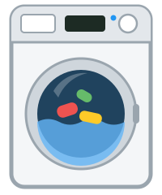
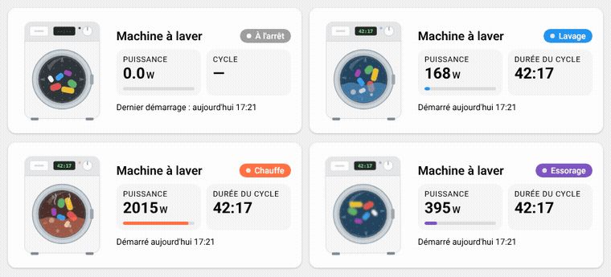

#  Machine à laver animée — carte Lovelace pour Home Assistant

[](https://hacs.xyz/)
[](LICENSE)


Une carte de tableau de bord qui représente un **lave-linge à hublot animé** : le tambour tourne, l'eau ondule et des bulles remontent pendant le cycle.
L'animation change selon la **phase du cycle**, déduite de la puissance consommée.
La carte affiche aussi la **puissance soutirée** et la **durée du cycle en cours**, mise à jour chaque seconde.

*An animated front-loader washing machine card for Home Assistant: drum animation per wash phase (wash / heating / spin), live power draw and running cycle time. Works with any smart plug that measures power.*



---

## ✨ Fonctionnalités

| Phase | Déclenchement (par défaut) | Animation |
|---|---|---|
| **À l'arrêt** | cycle non démarré | hublot sombre, tambour immobile |
| **Lavage** | 15 → 260 W | le tambour tourne dans les deux sens, eau et bulles |
| **Chauffe** | ≥ 1000 W | eau orangée, vapeur, bulles rapides |
| **Essorage** | 260 → 1000 W | rotation rapide, linge flou, la machine tremble |
| **Pause** | < 15 W pendant le cycle | tambour à l'arrêt, eau visible |

- Puissance en direct, avec une barre de niveau
- Durée du cycle (`mm:ss` ou `h:mm:ss`), aussi affichée sur le petit écran de la machine
- Heure de démarrage du cycle, et du dernier démarrage quand la machine est arrêtée
- Un appui ouvre la fenêtre de détail du capteur de puissance
- S'adapte au thème de Home Assistant (mode clair et sombre)
- Respecte le réglage système « réduire les animations » (`prefers-reduced-motion`)
- Éditeur visuel : choix du capteur de puissance et des seuils sans YAML
- Aucune dépendance : un seul fichier JavaScript

## 📦 Installation

### Via HACS (dépôt personnalisé)

1. HACS → menu ⋮ → **Dépôts personnalisés**
2. URL : `https://github.com/JVmaisGpeur/ha-washing-machine-card`, type : **Dashboard**
3. Installe **Machine à laver animée**, puis recharge la page (Ctrl+Maj+R)

### Manuellement

1. Copie `washing-machine-card.js` dans `/config/www/`
2. **Paramètres → Tableaux de bord → ⋮ → Ressources → Ajouter**
   - URL : `/local/washing-machine-card.js`
   - Type : **Module JavaScript**
3. Recharge la page (Ctrl+Maj+R)

## ⚙️ Configuration

### Éditeur visuel

Ajoute la carte **Machine à laver animée** depuis le sélecteur de cartes. Tous les réglages se font sans YAML :
- le **capteur de puissance** se choisit dans une liste qui ne montre que les capteurs en W, et la carte en propose un automatiquement ;
- l'indicateur « cycle en cours » et la date de début sont optionnels ;
- les **seuils de phase** se règlent dans une section dépliable.

### YAML

```yaml
type: custom:washing-machine-card
name: Machine à laver
power_entity: sensor.prise_machine_a_laver_power
running_entity: input_boolean.machine_a_laver_cycle_en_cours
start_entity: input_datetime.machine_a_laver_debut_du_cycle
heat_threshold: 1000
spin_threshold: 260
pause_threshold: 15
```

| Option | Obligatoire | Défaut | Description |
|---|---|---|---|
| `power_entity` | ✅ | — | Capteur de puissance en W (prise connectée) |
| `running_entity` | | — | `input_boolean` ou `binary_sensor` « cycle en cours ». Sans lui, la machine est considérée en marche dès que la puissance dépasse `pause_threshold` |
| `start_entity` | | — | `input_datetime` (date + heure) du début du cycle. Sans lui, c'est le `last_changed` de `running_entity` qui sert |
| `name` | | `Machine à laver` | Titre de la carte |
| `heat_threshold` | | `1000` | Puissance (W) à partir de laquelle la phase est « Chauffe » |
| `spin_threshold` | | `260` | Puissance (W) à partir de laquelle la phase est « Essorage » |
| `pause_threshold` | | `15` | En dessous de cette puissance (W), le tambour est en pause |

> 💡 **Régler les seuils** : regarde l'historique de ton capteur de puissance sur un cycle complet.
> En général, la résistance de chauffe tire 1800 à 2200 W, l'essorage 300 à 600 W et le lavage 100 à 250 W.

## 🤖 Automatisation recommandée (détection du cycle)

La carte marche avec la puissance seule, mais l'affichage est plus fiable quand une automatisation gère un indicateur « cycle en cours ». Les courtes pauses du tambour n'arrêtent alors pas le cycle à l'écran.

Crée d'abord deux entrées (helpers) :
- `input_boolean.machine_a_laver_cycle_en_cours`
- `input_datetime.machine_a_laver_debut_du_cycle` (date **et** heure)

```yaml
alias: Machine à laver - détection du cycle
mode: queued
triggers:
  - trigger: numeric_state
    entity_id: sensor.prise_machine_a_laver_power
    above: 15
    for: { minutes: 1 }
    id: debut
  - trigger: numeric_state
    entity_id: sensor.prise_machine_a_laver_power
    below: 10
    for: { minutes: 5 }
    id: fin
actions:
  - choose:
      - conditions:
          - condition: trigger
            id: debut
          - condition: state
            entity_id: input_boolean.machine_a_laver_cycle_en_cours
            state: "off"
        sequence:
          - action: input_boolean.turn_on
            target: { entity_id: input_boolean.machine_a_laver_cycle_en_cours }
          - action: input_datetime.set_datetime
            target: { entity_id: input_datetime.machine_a_laver_debut_du_cycle }
            data:
              datetime: "{{ now().strftime('%Y-%m-%d %H:%M:%S') }}"
      - conditions:
          - condition: trigger
            id: fin
          - condition: state
            entity_id: input_boolean.machine_a_laver_cycle_en_cours
            state: "on"
        sequence:
          - action: input_boolean.turn_off
            target: { entity_id: input_boolean.machine_a_laver_cycle_en_cours }
```

Tu peux y ajouter tes notifications (SMS, application mobile…) au début et à la fin du cycle.

## 🎨 Personnalisation

Deux variables CSS changent la couleur de la carrosserie. Ajoute-les à ton thème :

```yaml
wmc-body: "#f4f6f8"   # façade
wmc-panel: "#e3e7eb"  # bandeau de commande
```

## 🛠️ Compatibilité

- Développée avec une prise Meross (intégration `meross_lan`). Elle doit marcher avec toute prise qui fournit un capteur de puissance en W (Shelly, Tapo, Zigbee…).
- Compatible avec les vues **Sections** et Masonry, et avec les pop-ups **Bubble Card**
- Apparaît dans le sélecteur de cartes sous le nom « Machine à laver animée »

## 📄 Licence

MIT © 2026 [JVmaisGpeur](https://github.com/JVmaisGpeur)
